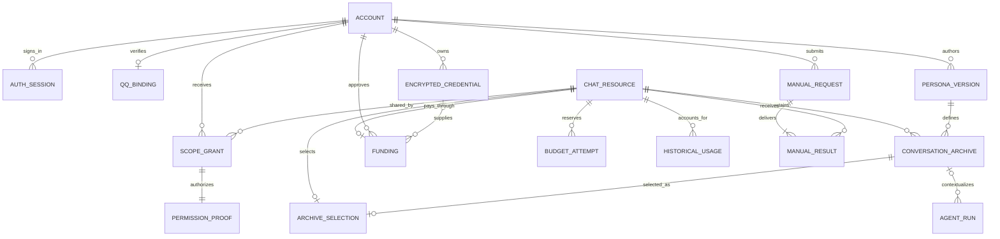

# 平台数据模型与权限边界

更新日期：2026-10-24。这里只描述公开结构；不展示任何真实账号、QQ、群、服务器、密码哈希或 API Key。源码与实际 schema 是权威，关系图中跨库连线是应用层约束，不代表 SQLite 跨文件外键。

## 业务对象

一个聊天资源由 `botId + group:号码/private:号码` 唯一确定。用户、机器人、聊天、人设版本、长期档案、单次 Agent 运行和付款来源分别建模。管理员是人的平台角色；普通账号与管理员使用同一套聊天服务。

同群多位管理者共享同一个当前档案、费用来源和每日额度。人设保存为新版本，明确应用才切换档案；A → B → A 优先恢复原 A 档案。无论切换多少次，当天费用归属仍是同一群/私聊，不能靠新建人设重置预算。

## 手动消息回执库 `manual-messages.sqlite`

| 表 | 主键及关键字段 | 职责 |
| --- | --- | --- |
| `manual_requests` | `user_id + request_id`；payload_hash、kind、created_at | 统一单发/群发任务与请求幂等；正文只存摘要，不在回执库重复保存 |
| `manual_results` | `user_id + request_id + ordinal`；chat_key、status、message_id、error、history_recorded、message_type、stage、tts_outcome、estimated_cost_micros | 每个目标的传输结果、原档案落盘标记及语音合成阶段；外键指向请求 |

schema 2 保留 schema 1 文字回执，增加语音阶段字段。真实语音费用仍由统一预算账本管理，不把回执估算费用再统计一次。云合成与QQ传输结果未知均保留，不因重启重合成或重发。详见[手动消息](MANUAL_MESSAGES.md)。

## 独立账号库 `platform.sqlite`

| 表 | 主键及关键字段 | 职责 |
| --- | --- | --- |
| `accounts` | `id`；唯一 `username`；`role`、`disabled`、密码算法/盐/哈希/版本、时间 | 保留迁移前稳定账号；唯一平台管理员；不存 API Key |
| `auth_sessions` | `hash`；`account_id`、`password_version`、创建/到期时间 | 只存 Cookie token 的 SHA256；注销、密码变化、停用和管理员撤销实时生效 |
| `account_scopes` | `account_id + bot_id + conversation_key` | 精确显式或群核验授权；同号群/私聊互不混用 |
| `scope_proofs` | 同上；`source`、`epoch`、验证/到期时间、`revoked` | 区分显式委托和 QQ 自动群证据；自动证据两分钟有效 |
| `account_epochs` | `account_id`；`epoch` | 相关角色、密码、停用、QQ 绑定变化使该账号的在途权限凭证失效 |
| `qq_bindings` | `qq`；唯一 `user_id`、`verified_at` | 一个 QQ 只能绑定一个账号，一个账号只绑定一个 QQ；本人私聊权限由此派生 |
| `binding_challenges` | `id`；账号、QQ、唯一 `code_hash`、到期/次数/消费时间 | 私聊可信事件完成挑战；输入 QQ 号不等于证明所有权 |
| `managed_conversations` | `bot_id + conversation_key` | 同群唯一资源目录；不复制每位管理者的群记录 |
| `platform_meta` | `key`；`value` | 全库编辑 CAS 版本；不作为所有聊天统一的在途作业版本 |
| `account_imports` | `source_id`；digest、计数、时间 | 私有导入追溯与幂等；重复快照不恢复已撤销会话或覆盖新状态 |

源于可信 QQ 群核验的权限会过期，并响应群主/管理员变更、移除或机器人退群事件。续证在授权未变化时保留 scope epoch；登录新 session 不改变任何群 epoch。付费与发送复核使用相关 `account epoch + scope epoch`，后台续证不能在等待 OneBot 返回后复活已被撤销的 scope。

## 业务库 `platform-business.sqlite`

| 表 | 主键及关键字段 | 职责 |
| --- | --- | --- |
| `business_personas` | `id`；`owner_id`、`chat_key`、`origin_id`、`version`、`public` | 人设作者/共享范围与不可变版本链；正文在档案库的 `archive_personas` |
| `business_credentials` | `id`；所有者、端点、模型、iv/ciphertext/tag、版本、启用状态 | AES-GCM 密文，AAD 绑定所有者和配置身份；主密钥在独立私有文件，不入数据库或 Git |
| `business_funding` | `chat_key`；出资人、mode、credential、版本、限额、启用状态 | 当前公共机器人每群/私聊一份费用来源；平台、本人试用、自带 Key 或禁用 |
| `business_usage` | `source_id + id`；chat/date/amount、原口径 JSON、hash | 旧费用追溯与去重；不再计入切换日 seed 第二次 |
| `business_meta` | `name`；JSON | 平台体验策略、来源记录摘要与配置 |

当前业务库只承载主公共机器人，`chat_key` 的唯一键在该边界成立；多机器人托管不在本轮恢复范围。若未来扩展，须先迁移业务键为完整 `bot_id + chat_key`，不能直接复用聊天数字。

自带 Key 在每次后台调度时复核其所有者仍启用并仍有聊天权限。选用某个 Key 不授予群权限；普通用户不能提高平台体验补贴、读取他人 Key 或让无效自带 Key 自动回退平台。模型、工具和记忆仍进入同一 Agent。

## 档案库 `conversation-archives.sqlite`

| 表 | 主键及关键字段 | 职责 |
| --- | --- | --- |
| `archive_sources` | `bot_id + id`；coverage JSON | 原始来源与正文/消息/媒体/历史覆盖说明 |
| `archive_personas` | `bot_id + id`；name/content/version/history/source | 可保留的具体人设版本与正文 |
| `conversation_archives` | `bot_id + id`；chat/persona/source、continuation、legacy ID、revision、chat/transcript JSON、计数 | 长期人设档案；保存原始来源与消息，和单次 Agent 工作分开 |
| `archive_selections` | `bot_id + chat_key`；archive ID、version | 每聊天一个当前档案；切换 epoch 防止 A/B/A 旧任务复活 |
| `archive_imports` | `bot_id + source_id + kind + item_id`；fingerprint/payload | 前缀补导与幂等；不覆盖新写入历史或选择 |

schema 3 将消息和 transcript 数量保存为元数据并建立 chat 索引。列表只查元数据；读目标档案才解析正文。写入对当前档案单行 CAS，不因每条消息扫描全部历史。

## 预算、运行记录与其余存储

`paid-calls.sqlite` 当前物理表为 `paid_documents(name, body)`：预算内核文档保存每日策略和尝试记录，包含 reserve/dispatched/settled/released/unknown、精确聊天、操作 ID、预留/实际微元、时间与未知原因。这里仍是 SQLite 内的受校验文档，不应把概念 ER 中的 `BUDGET_ATTEMPT` 误称为已经逐条规范化的物理表。

本轮新增腾讯 TTS 服务预留：同一事务同时占用原聊天预算、`speech-subsidy-budget` 的该群/私聊补贴预算和 `speech-platform-budget` 的平台语音总预算；试用付款另占原试用总额。三类基础 hold 不是三次语音调用，不能把关联预留累加成三笔实际消费。请求发送后失败或交付未知保留 unknown，不因失败文字回退或跨日直接释放。`speech-cooldown` 文档持久保存各完整聊天键的最近调度时间。

## 语音设置库 `speech.sqlite`

| 表 | 主键及关键字段 | 职责 |
| --- | --- | --- |
| `speech_meta` | `name`；`value_json` | 平台语音开关、版本、音色/语速/音量、自动语音概率、单条字符上限、最短间隔、平台每日补贴上限 |
| `speech_scopes` | `chat_key`；`version`、`enabled`、`max_chars`、`cooldown_ms`、`voice_type`、`speed`、`volume`、`auto_voice_percent` | 每个群/私聊共享一份语音设置；可空参数继承平台，普通管理者只操作自己的授权资源，不能提高平台限制 |
| `speech_subsidies` | `chat_key`；`version`、`enabled`、`modes_json`、`daily_limit_micros` | 管理员明确允许哪些 LLM 付款模式使用该资源的平台 TTS 补贴，以及该资源补贴上限；默认不授权 |

当前仍限主公共机器人，表内 `chat_key` 使用完整 `group:` / `private:`，同号不混用。平台和资源设置采用版本 CAS；开关、补贴和出资/档案权限在合成前后、排队后再核验。普通用户自带模型 Key 不等于自动获得平台 TTS Key。语音凭据不存本库，只由独立私有文件读取，公开状态只有是否配置；准备方式见 [腾讯语音凭据](TENCENT_SPEECH_CREDENTIAL.md)。本地语音费用按标价估算，未同步免费包实际抵扣。

schema 2 增加资源音色/语速/音量三列，schema 3 再增加自动语音概率；已有 schema 1/2 先校验、再事务升级，已有资源取平台默认值，不改原费用账本或预算初值。平台初始音色 `101001`、语速/音量 `0`、自动概率 `0%`；可选音色只来自固定同价精品目录，不能传入任意 ID 引入其他价类。未知 schema 或无本库身份的文件拒绝接管。

## 原生文件与验证边界

人设档案和账号库之外，上游原生的单次 Agent 运行记录、部分记忆、用量报表及全局配置仍保留文件存储。这次迁移不等于将 QQ Agent 的所有存储都换成 SQLite，也不等于重放 DSH 的专属执行器。运行详情默认不返回庞大 provider raw；管理员点击 JSON 时才读取。

表情本轮新增独立 `scoped-stickers.json`（版本 1），以 `botId + 完整聊天键 + 内容 SHA` 定位条目，保存本聊天的图片元数据、备注/标签、使用记录及持久小时收录时间。图片在对应聊天的内容哈希目录，群和私聊同号也不共享可发送 ID；原 `stickers.json` 和 QQ 全局收藏保留为归属未证明的旧资料，不据旧 `source` 字段默认发布。它仍是受校验、原子落盘的本地文件，不冒称已建 SQL 表；全局/单聊天的磁盘、数量和频率共同约束，细节见 [扩展与原生补强](EXTENSIONS.md)。

一段会话历史能够恢复，不保证供应商的提示缓存仍命中。账本金额来自约定价格与可验证用量，是平台估算，供应商实际账单是另一条事实来源。跨午夜、未知用量、重试和平台体验总额需继续遵守统一预算内核约束。

相关实现：`src/platform-store.js`、`platform-auth.js`、`platform-business.js`、`conversation-archives.js`、`conversation-budget.js`、`paid-call-guard.js`、`speech-service.js`。公开帮助页仅演示以上结构，不提供数据库浏览功能。
